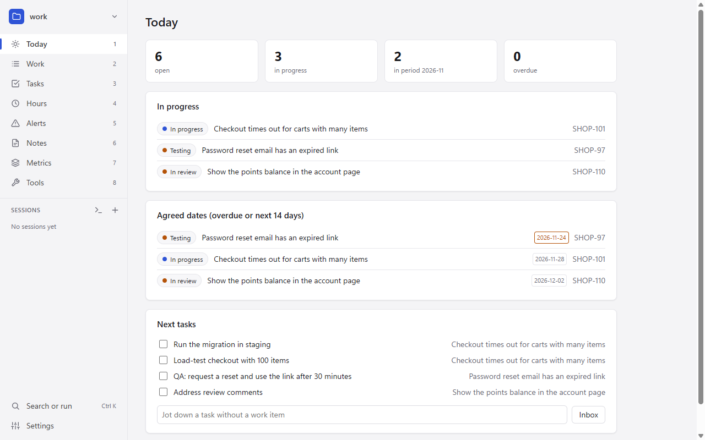
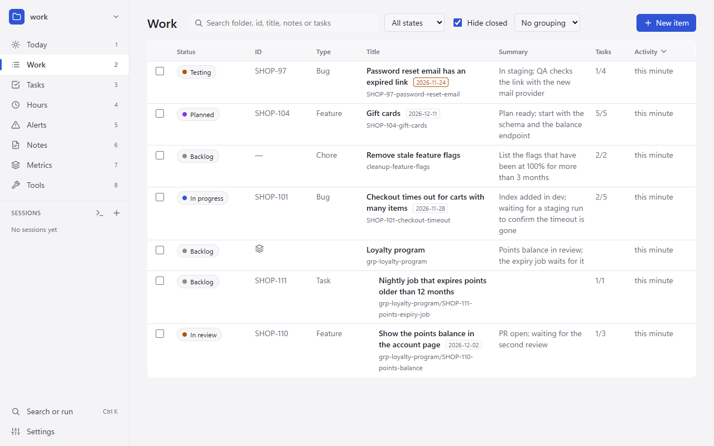
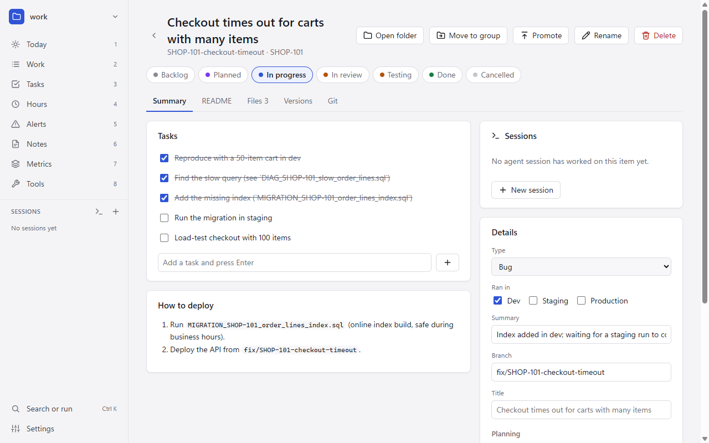
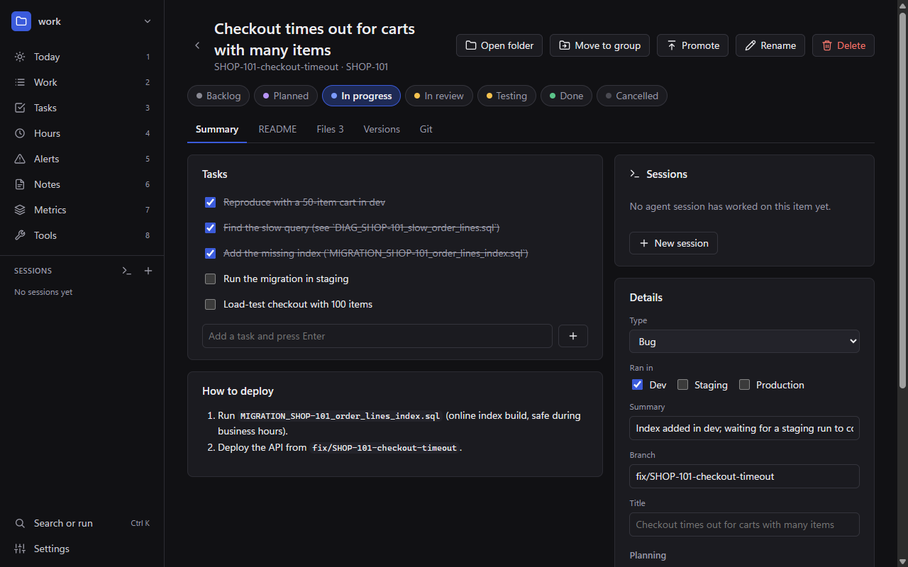

# Workboard

A desktop workspace for the work you do with AI coding agents.

Each piece of work is a folder with a `README.md`: its status lives in the README's frontmatter and its
tasks in a checklist section. Workboard shows all of them, keeps them up to date as files change, and runs
agent sessions (Claude Code, GitHub Copilot CLI or any CLI that speaks MCP) in an embedded terminal. The
agents read and update that same state through the `workboard` MCP server, so you, the agents and your
editor all work on plain files.

> **Status: 0.1.0, early.** Workboard is a Rust + Tauri rewrite of a Python app used daily. The core,
> agent sessions, the Git panel, the Azure DevOps integration and plugins are done and tested against the
> original's behavior; parts of the UI (keyboard shortcuts, a configurable grid, saved views, the
> file viewer) are still being ported. See [`docs/parity-checklist.md`](docs/parity-checklist.md)
> and the [changelog](CHANGELOG.md). Expect rough edges and format changes before 1.0.

## Screenshots

All taken with [`examples/demo-work`](examples/demo-work).

| Today | Work |
|---|---|
|  |  |
| **Item detail** | **Dark theme** |
|  |  |

## Features

### Work folders as the source of truth

Open any folder: each sub-folder is an item, its `README.md` frontmatter holds status, type,
environments, notes, branch, agreed date and hours, and `## Tasks` holds its checklist. `grp-*` folders
group related items. Files are categorized by name (`MIGRATION_…`, `DIAG_…`, `PLAN_…`) and scripts can be
marked as ran in each environment. Every README write keeps a backup that can be restored from
**Versions**.

The file viewer shows each file of an item in place, offline: SQL with syntax colors, Markdown (with
` ```mermaid ` blocks drawn), images, PDF, draw.io diagrams (multi-page, with the official viewer bundled
locally) and Mermaid (`.mmd`/`.mermaid`). **Open with app** is always there for the rest.

```markdown
---
status: in-progress
type: bug
environments: [dev]
notes: Index added in dev; waiting for a staging run
branch: fix/SHOP-101-checkout-timeout
due: 2026-11-28
hours: 6
---
# Checkout times out for carts with many items

## Tasks

- [x] Find the slow query
- [ ] Run the migration in staging
```

### Live

Nothing is cached: edit a README in your editor, let an agent change it, pull a branch, and the views
refresh within seconds. Views: **Today**, **Work**, **Tasks**, **Hours**, **Alerts**, **Notes**,
**Metrics**, **Tools** and **Settings**, plus a command palette (`Ctrl+K`).

### Agent sessions

Start a session on one or more items and the agent runs in an embedded terminal with a context file
describing its items and the `workboard` MCP server to update them (status, tasks, notes, scripts the user
ran). With Claude Code, hooks show whether each session is working, needs you or is idle. Sessions can be
paused, resumed, split, renamed and pinned, and long sessions get a recommendation (new session, handoff or
compact). **Plan** opens a planning session and checks that the plan is complete before the agent stops.
See [docs/agents.md](docs/agents.md).

### Learning from your sessions

**Hours** per item and period, from the sessions' activity. **Metrics** per session (tokens, tools,
prompts, progress of its items). **Reflect** has a session read the evidence of past sessions and propose
improvements to instructions, skills or tools, as a note you can apply with **Apply candidates…**.
**Review** has another model review an item's branches against its acceptance criteria. **Tools** turns
scripts that sessions keep rewriting into promoted tools, frozen by hash, that agents run through the MCP
server.

### Git panel (read-only)

For each item, the branches whose name carries its id in the repos next to the work folder, and whether
that work is already in each environment: *merged*, *equivalent* (same patch, or a `cherry-pick -x`),
*content* (same files, e.g. after a squash), *mentioned* or *pending*. Alerts for repos out of step and
uncommitted changes. **Promote** generates the cherry-pick or merge commands (PowerShell or Bash) and the
pull request URL; Workboard never runs them. Only read-only git subcommands are allowed.

### Trackers

Link a work folder to Azure DevOps with a read-only token: sync states with a preview (fills, types,
advances, moves back, per git), see what is **Assigned this period**, create items from work items and,
with a separate write token and only on request, **Change state in Azure DevOps**. Tokens stay in the
system credential store. See [docs/trackers.md](docs/trackers.md).

### Configurable workflow

States, types, environments, periods, folder names, frontmatter keys and file categories come from a
preset; two are included and plugins can add more. See [docs/workflow.md](docs/workflow.md).

### Plugins

Separate executables, in any language, that add actions (forms, results, sessions) and workflow presets.
They talk JSON-RPC over stdio, with permissions declared in a manifest. Single-file SDKs for Python and
Node (`sdk/`) handle the protocol, and `workboard plugin new <id>` creates a ready-to-enable plugin. See
[docs/plugins.md](docs/plugins.md).

## Principles

- **Files are the source of truth.** Workboard only writes the frontmatter and the task lines of each
  README (and creates, moves or renames folders when you ask); everything else (settings, caches, backups)
  lives in its own config folder.
- **Read-only by default.** Git is read-only; promotions only generate the commands for you to run.
  Task trackers are read-only unless you explicitly push a change.
- **Configurable workflow.** States, types, environments, periods and folder conventions come from a
  preset (`crates/wb-core/presets/`), not from code.
- **Offline UI**, no CDNs.

## Install

Download the installer for your system from the **Releases** page of this repository:

| System | Files |
|---|---|
| Windows | `.msi` or `…-setup.exe` |
| macOS (Apple silicon and Intel) | `.dmg` |
| Linux | `.AppImage`, `.deb` or `.rpm` |

Builds may be **unsigned**:

- **Windows**: SmartScreen may say *Windows protected your PC*. Choose **More info → Run anyway**.
- **macOS**: if it says the app *cannot be opened* or *is damaged*, right-click the app in Applications
  and choose **Open**, or run `xattr -dr com.apple.quarantine /Applications/Workboard.app`.
- **Linux**: make the AppImage executable (`chmod +x Workboard_*.AppImage`). Tracker tokens need a Secret
  Service provider (GNOME Keyring, KWallet).

Optional, for the features that use them: `git` on the `PATH` (Git panel) and the agent CLIs you want to
run (`claude`, `copilot`). The `workboard` MCP server (`wb-mcp`) and the hook (`wb-hook`) are installed
next to the app.

## Quick start

`examples/demo-work/` is a small fictional work folder for the default preset: items in several states and
types, a `grp-loyalty-program` group with two items, tasks, a plan and categorized files.

1. Copy `examples/demo-work` somewhere (Workboard writes to its READMEs as you use it).
2. Open Workboard and choose that folder. **Work** lists the items and the group; **Today** shows what is
   in progress and the agreed dates coming up.
3. Open `SHOP-101-checkout-timeout`: change its status, tick a task, look at **Files** (a diagnostic and a
   migration you can mark as ran in dev, staging or prod) and at **Versions** after a change.
4. Edit a README in your editor: the change shows up in a couple of seconds.
5. With Claude Code installed, start a **New session** on an item and ask the agent to add a task. It
   calls `workboard_session` and `workboard_add_task`, and the task appears in the app. Or use **Plan** on
   `SHOP-111-points-expiry-job`.

Without installing, from a clone (see [Development](#development)):

```sh
WORKBOARD_CONFIG_DIR=/tmp/wb-demo cargo run -p wb-api --bin wb-devserver -- examples/demo-work
npm install && npm run dev        # then open http://localhost:1420
```

## Configuration

Settings, caches, backups, session files and promoted tools live in the configuration folder:

| System | Folder |
|---|---|
| Windows | `%APPDATA%\Workboard2` |
| macOS | `~/Library/Application Support/Workboard2` |
| Linux | `$XDG_CONFIG_HOME/Workboard2` (usually `~/.config/Workboard2`) |

Set **`WORKBOARD_CONFIG_DIR`** to use another folder, for testing or to run a second, independent
instance. The full list of files is in [docs/architecture.md](docs/architecture.md#configuration-folder).
Tracker tokens are not there: they are in the system credential store.
Coming from the v1 (the Python app)? `workboard migrate-v1 --dry-run` shows what it would import from
`%APPDATA%\Workboard` and `workboard migrate-v1` imports it: see [docs/migrate-v1.md](docs/migrate-v1.md).

## Development

Requirements: Rust (stable), Node 22, and on Linux the WebKitGTK dev packages.

| What | Command |
|---|---|
| Run the app | `npm install` then `npm run tauri dev` |
| UI in a browser against the real backend | `cargo run -p wb-api --bin wb-devserver -- <folder>` and `npm run dev` → <http://localhost:1420> |
| Tests | `cargo test --workspace`, `npm test` (UI and Node SDK) and `python -m unittest discover -s sdk/python/tests` |
| Lint | `npm run bins` once (the app crate needs `wb-mcp` and `wb-hook` built), then `cargo fmt --all --check && cargo clippy --workspace --all-targets -- -D warnings` |
| Installers | `npm run tauri build` (CI builds them for the three systems on a `v*` tag) |
| Regenerate golden files (needs the v1) | `py tests/golden/gen/gen_all.py` |

Set `WORKBOARD_CONFIG_DIR` to a temporary folder when testing, so you don't touch your real settings.
How the code is organized, the data flow and the testing strategy are in
[docs/architecture.md](docs/architecture.md).

## Layout

```
crates/wb-core      workflow presets, work folders, frontmatter, tasks, safe README writes
crates/wb-api       the app API (used by the window and by the dev server)
crates/wb-mcp       the `workboard` MCP server agents use
crates/wb-sessions  agent sessions: terminals, hooks, hours, metrics, reflect
crates/wb-git       the read-only Git panel and promotion data
crates/wb-tracker   trackers (Azure DevOps)
crates/wb-plugins   plugin manifests, the JSON-RPC runner and `workboard plugin new|check`
sdk/                plugin SDKs for Python and Node (single files, no dependencies)
crates/wb-hook      the hook binary agent CLIs call
crates/wb-i18n      translations, shared with the UI (locales/*.json)
crates/wb-platform  config folder, credential store, opening files, process trees
src-tauri/          the desktop app and its commands
ui/                 the UI (TypeScript + Vite)
locales/            UI and agent texts (en, es)
examples/           a demo work folder and an example plugin
tests/golden/       reference behavior captured from the v1
docs/               documentation
```

## Documentation

- [Workflow presets](docs/workflow.md): states, types, folders, fields, file categories, git rules.
- [Agent sessions and the MCP server](docs/agents.md): agents, what each session gets, MCP tools, hooks,
  Plan / Reflect / Review, tools.
- [Trackers](docs/trackers.md): Azure DevOps setup, state mapping, sync, writing states, adding a tracker.
- [Plugins](docs/plugins.md): manifest, protocol, host methods, trackers, SDKs, `workboard plugin`.
- [Architecture](docs/architecture.md): crates, data flow, config folder, dev server, tests, conventions.
- [Migrating from the v1](docs/migrate-v1.md): `workboard migrate-v1`, what it imports and what not.
- [Parity checklist](docs/parity-checklist.md) (Spanish): what is ported from the v1.
- [Changelog](CHANGELOG.md).

## License

[MIT](LICENSE). Bundled third-party code is listed in [THIRD_PARTY.md](THIRD_PARTY.md).
